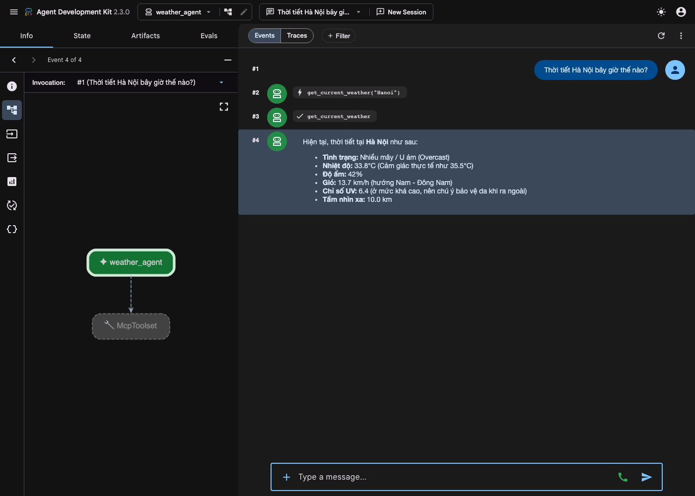
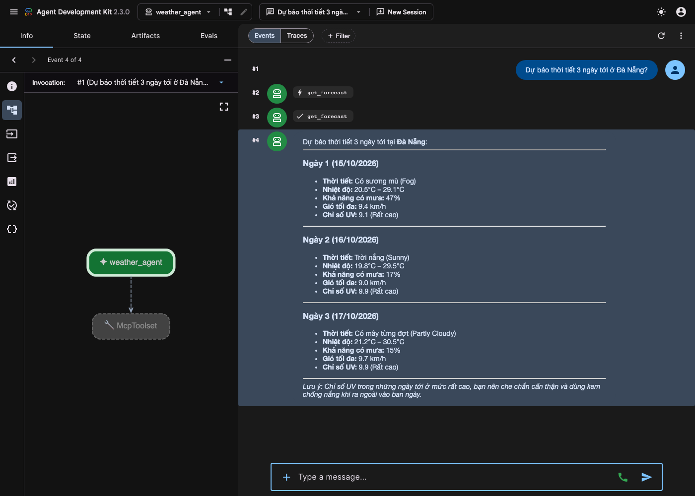

# Kết quả chạy lab — Day 26 MCP

Sinh viên: Trần Nguyễn Thái Duy — 2A202602991

| Bước | Kết quả | File |
|---|---|---|
| 01 — Function Calling (Gemini) | ✅ Model tự gọi `get_weather` cho Hà Nội, Đà Nẵng, app thực thi và model tổng hợp câu trả lời | [01-function-calling.txt](01-function-calling.txt) |
| 02 — MCP basics (stdio) | ✅ Client `list_tools` + `call_tool` tới MCP server | [02-mcp-basics.txt](02-mcp-basics.txt) |
| 03 — Auth (Bearer token) | ✅ Có token → gọi tool thành công; không có token / token sai → HTTP 401 | [03-auth.txt](03-auth.txt) |
| 03 — Tool Registry | ✅ Tìm tool theo tag `weather`, chọn best match `get_weather_v2` | [03-registry.txt](03-registry.txt) |
| 03 — Versioning | ✅ `get_weather` (v1) và `get_weather_v2` chạy song song | [03-versioning.txt](03-versioning.txt) |
| 04 — ADK agent + MCP server + WeatherAPI | ✅ Agent gọi tool qua Streamable HTTP, trả dữ liệu thời tiết thật | ảnh bên dưới |

## Lab 04 — ADK Web UI

Thời tiết hiện tại Hà Nội — agent gọi `get_current_weather("Hanoi")`:

Dự báo 3 ngày Đà Nẵng — agent gọi `get_forecast`:

## Ghi chú

- `gemini-2.5-flash` không còn mở cho tài khoản mới (404), nên lab 01 và lab 04 đọc model từ biến
  `GEMINI_MODEL` (mặc định `gemini-flash-latest`). Khi chạy gặp 503 (quá tải) / 429 (hết quota free tier)
  thì đổi sang model khác, ví dụ `GEMINI_MODEL=gemini-3.7-flash` — kết quả trên chạy với model này.
- Máy chạy có container Docker khác chiếm cổng 8000, nên demo auth bước 03 được chạy với cổng 8010
  và ADK web chạy với `adk web --port 8001`. Logic code không đổi.
